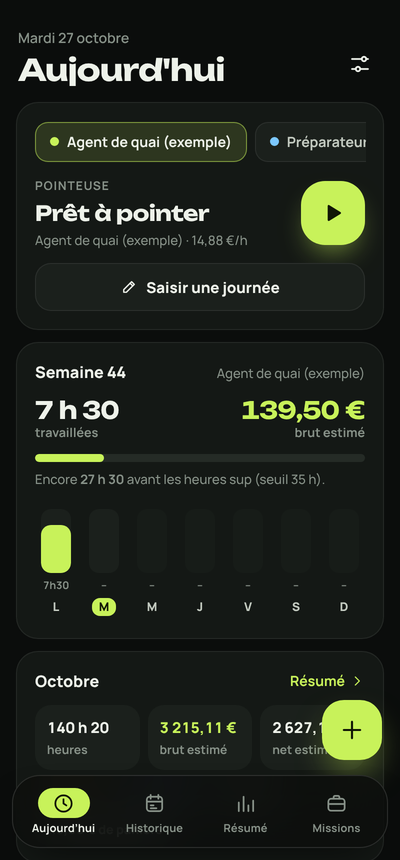
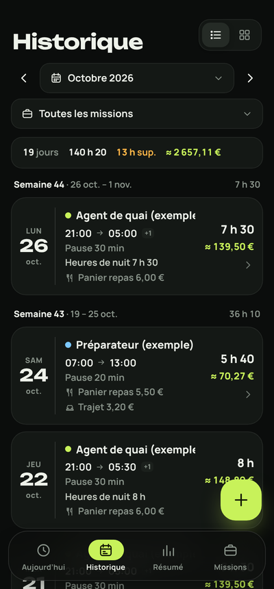
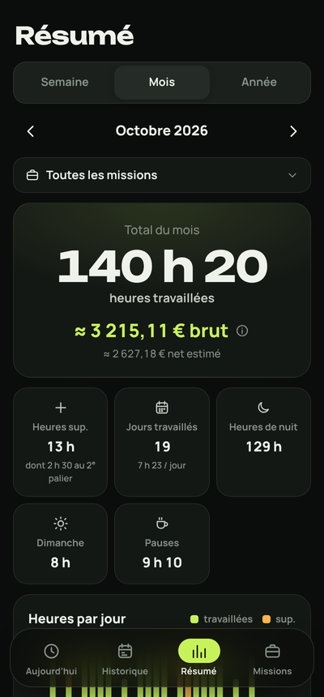
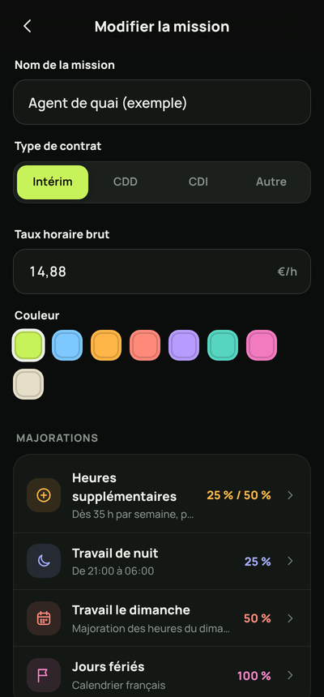

<div align="center">

**English** · [简体中文](README_zh.md) · [繁體中文](README_zh-TW.md) · [日本語](README_ja.md) · [한국어](README_ko.md) · [Türkçe](README_tr.md) · [Русский](README_ru.md) · [Tiếng Việt](README_vi.md) · [ไทย](README_th.md) · [Deutsch](README_de.md) · [Español](README_es.md) · [Français](../../README.md) · [Українська](README_uk.md) · [Polski](README_pl.md) · [Português (Brasil)](README_pt-BR.md) · [العربية](README_ar.md) · [فارسی](README_fa.md) · [Bahasa Indonesia](README_id.md) · [Italiano](README_it.md)
· [Ελληνικά](README_el.md) · [മലയാളം](README_ml.md) · [Roman Urdu](README_ur-Latn.md) · [Română](README_ro.md)

</div>

<p align="center"></p>

<h1 align="center">Fable</h1>
<p align="center"><b>Your hours, your gross pay, no calculator.</b><br>Hours tracker for French temp work (intérim), fixed-term (CDD) and permanent (CDI) contracts: tiered overtime, nights, Sundays, public holidays, meal allowances, IFM and paid leave.</p>

<p align="center"><a href="https://github.com/apk-fold/fable/releases/latest/download/fable.apk"><b>⬇️ Download the APK</b></a> · Android 7 and up · free, offline, no account</p>

<p align="center">
  
  
  
  
</p>

## Install

1. On your phone, open the **Download the APK** link above (or the latest [release](https://github.com/apk-fold/fable/releases/latest)).
2. Allow installation from your browser if Android asks, then install.
3. New versions install over the old one: same signature, data kept.

Every code change pushed to `main` rebuilds the APK automatically (GitHub Actions) and publishes a new release.

### Signing

The signing key is not in the repository. GitHub Actions reads it from the **`FABLE_KEYSTORE_B64`** secret (the `.jks` file encoded in base64, with an optional `FABLE_KEYSTORE_PASSWORD` password). Without this secret, the APK is signed with a temporary key: it installs, but the next version will ask you to uninstall the previous one.

## What the app does

**Entry**
- Time clock: *Start*, *Break*, *Finish* — the day is created on its own (optional rounding to the quarter hour).
- Manual entry: date, start → end (shifts past midnight handled), break, **+ Overtime** buttons (+15 min, +30 min, +1 h).
- Live preview of the calculation while you type, and a warning if two days overlap.
- Repeat a day on other days of the week, duplicate a day, force or remove the meal allowance case by case.

**Assignments** (one per employer or agency), each with its own rules:
- Contract type: Temp (intérim), Fixed-term (CDD), Permanent (CDI), Other — gross hourly rate, color.
- **Overtime** per week or per day, with 2 tiers (e.g. +25% from 35 h, +50% from 43 h).
- **Night hours** over an adjustable range (9 pm → 6 am by default) with their own premium.
- **Sundays** and **public holidays**: **Metropolitan France (Paris)** calendar by default, or **Alsace-Moselle** (+ Good Friday and December 26), set for all assignments.
- Stacking premiums: added together or only the highest; Saturday-to-Sunday nights counted by the start day or hour by hour.
- **Meal allowance** every working day or from a minimum number of hours, **travel allowance** per day.
- **IFM** (end-of-assignment allowance, temp work) or **end-of-contract bonus** (CDD) and **ICCP** (paid-leave allowance), 10% + 10% by default.
- **Pay period** over the full calendar month or offset (e.g. from the 21st to the 20th), default hours and break.

**Tracking**
- Home: time clock, current week with the overtime threshold gauge, month totals.
- History by month, as a list grouped by week or as a calendar, with a filter by assignment.
- Week / month / year summary: hours, overtime by tier, nights, Sundays, holidays, days worked, chart, gross pay breakdown down to the **estimated net** (adjustable contribution rate).
- **PDF export** (timesheet ready to send), **Excel .xlsx** and **CSV** — no subscription.

**Everything else**
- Reminder notification on the days and at the time you choose.
- **Everything is customizable** in Settings: dark, black (AMOLED), light or auto theme; main color and premium colors (palette or any color); fonts; text size; corners; density; animations; duration format (7 h 30, 7h30 or 7.5 h); discreet mode that hides amounts; start screen; history view. Any color for each assignment too.
- Backup / restore to a `.json` file, plus an automatic safety copy in the app's private files.
- No data leaves the phone: no account, no server, no ads.

## How it's calculated

Each day is split minute by minute. For every minute worked, Fable knows whether it falls at night, on a Sunday or on a public holiday, and in which overtime tier (weekly total from Monday to Sunday, in chronological order). The break is deducted pro rata. A week that straddles two months is calculated in full, then only the days inside the period are counted.

- Gross pay = hours × rate + premiums
- IFM / end-of-contract bonus = gross × 10%
- ICCP = (gross + IFM) × 10%
- Estimated net = total gross − contributions (22% by default) + meal and travel allowances

These are **estimates**: your collective agreement and your payslip are what count.

## Development

```bash
npm install
npm run dev        # interface in the browser
npm test           # calculation engine tests
npm run sync       # web build + Android project (after "npx cap add android" the first time)
npm run open       # opens the project in Android Studio
```

Structure: `src/core` (calculations, public holidays, storage, PDF/Excel exports), `src/views` (screens), `src/ui` (components), `scripts/patch-android.mjs` (name, icons, theme and signing of the Android project), `tests/` (engine tests and interface walkthroughs).

Stack: HTML/CSS/JS with no framework, [Vite](https://vitejs.dev), [Capacitor 8](https://capacitorjs.com), [pdf-lib](https://pdf-lib.js.org). Manrope and Unbounded fonts (SIL Open Font License).
